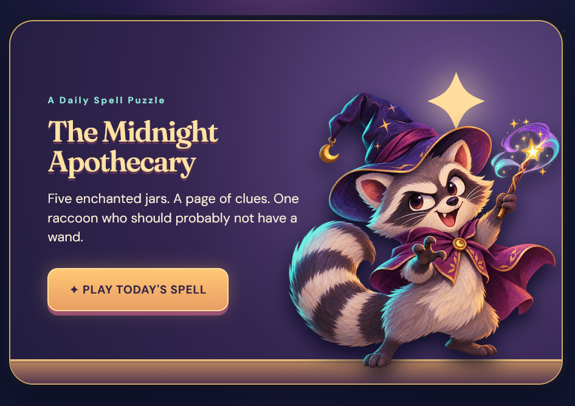
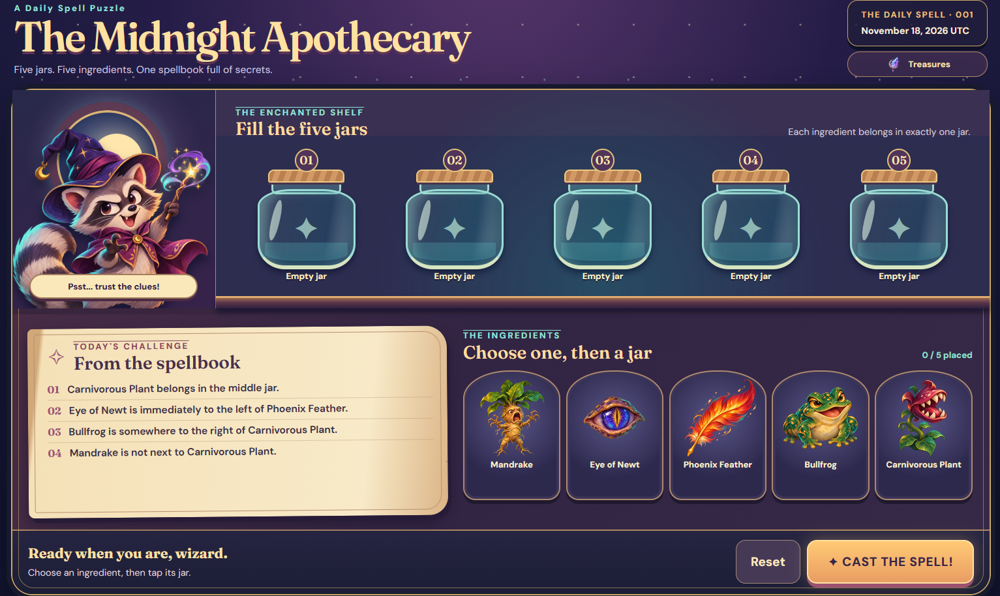
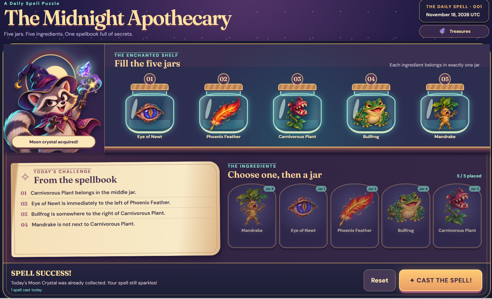
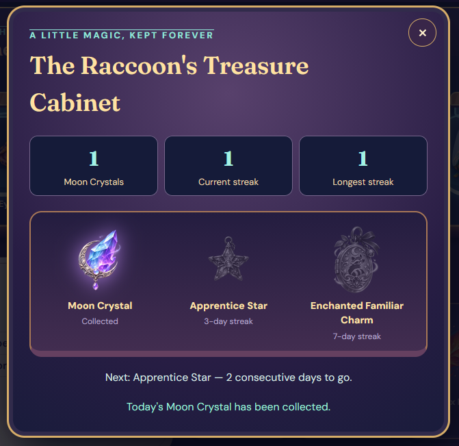
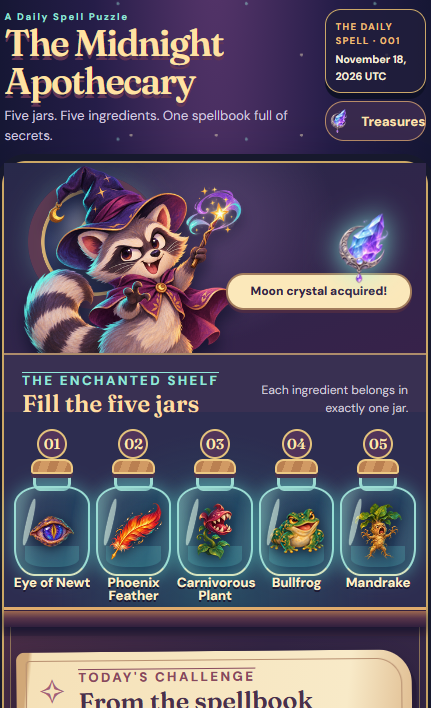

# The Midnight Apothecary

*A Daily Spell Puzzle*

A mischievous wizard raccoon has five enchanted jars, five magical ingredients, and a spellbook full of clues. Place each ingredient in its proper jar, cast the spell, and collect a little moonlight. The Midnight Apothecary brings playful illustration, approachable deduction, and accessible tap or keyboard controls to Reddit.

**Play the game:** [The Midnight Apothecary on Reddit](https://www.reddit.com/r/midnight_apothecary/comments/1xznz7o/releasetheraccoon/)

**Hackathon submission:** [View on Devpost](https://devpost.com/software/the-midnight-apothecary)

## How to play

1. Read the spellbook clues. Each ingredient belongs in exactly one numbered jar.
2. Select an ingredient and a jar in either order. You can move an ingredient or change a filled jar without creating duplicates.
3. Press **CAST THE SPELL!** to check your arrangement. A wrong spell keeps your choices so you can try again. **Reset** clears the jars, and progressive hints offer a nudge without revealing the answer.

The five ingredients are **Mandrake**, **Eye of Newt**, **Phoenix Feather**, **Bullfrog**, and **Carnivorous Plant**. Clues describe positions and relationships, such as “immediately to the left,” “somewhere to the right,” and “not next to.” The Moon Crystal is a reward, not a puzzle ingredient.

## Daily spells and treasures

The collection contains **30 curated puzzles**. Every clue set is checked against all **120 possible arrangements** and has exactly one solution, with no redundant clues. The daily spell is selected deterministically by UTC date: spell 1 begins **November 18, 2026**, and the collection rotates after spell 30. Everyone sees the same challenge on the same UTC day.

A signed-in player earns one **Moon Crystal** for their first successful spell each UTC day. Consecutive completions build a streak; a missed day resets the current streak but does not remove earned treasures. A **3-day streak** unlocks the Apprentice Star, and a **7-day streak** unlocks the Enchanted Familiar Charm. The **Treasure Cabinet** beside the daily date shows crystals, streaks, and collectibles. Hints and retries do not affect rewards. Player progress is stored per Reddit account in Devvit Redis, and the server verifies each completed spell before awarding it.

## Screenshots

| Splash screen | Daily puzzle |
| --- | --- |
|  |  |

| Successful spell | Treasure Cabinet | Mobile layout |
| --- | --- | --- |
|  |  |  |

## Built with

**Reddit Devvit**, **React**, **TypeScript**, and **Redis**. The clue engine and UTC puzzle selection are separate from the React interface. Original apothecary illustrations are in `public/apothecary`.

## License & Attribution

The Midnight Apothecary was created by **Sabrina Palis** and is maintained on GitHub as [MinervaRose](https://github.com/MinervaRose). Original game source code is **Copyright © 2026 Sabrina Palis** and available under [BSD-3-Clause](LICENSE). The project uses Reddit's Devvit React starter template, **Copyright © 2025 Reddit Inc.**, also under BSD-3-Clause; its notice and conditions are preserved in `LICENSE`.

**Original game artwork and screenshots © 2026 Sabrina Palis, where protected by applicable law. Rights reserved to that extent.** This includes illustrations in `public/`, screenshots in `docs/screenshots/`, and original apothecary backgrounds and decorative artwork. These creative assets are not licensed for reuse under BSD-3-Clause. See [ARTWORK-LICENSE.md](ARTWORK-LICENSE.md) for the asset scope. Third-party materials retain their own rights and notices.

## AI-Assisted Creation

The Midnight Apothecary was created by Sabrina Palis with the assistance of generative AI tools for software development and illustration. The game's concept, creative direction, puzzle design decisions, and final review were guided by Sabrina Palis.

## Local development

Use **Node.js 24.18.0** (see `.nvmrc`) and npm. Devvit playtesting requires a Reddit account with access to the configured test subreddit.

```sh
npm ci
npm run login
npm run dev
```

`npm run dev` starts the Devvit playtest. The inline splash opens the expanded puzzle view. The application identifier in `devvit.json` remains unchanged.

## Checks

```sh
npm run test:unit
npm run test:types
npm run lint
npm run build
```

The unit tests cover clue semantics, all 30 unique solutions, placement behavior, UTC rotation, streaks, duplicate completion requests, and storage failures. The production build bundles the Devvit client and server.
